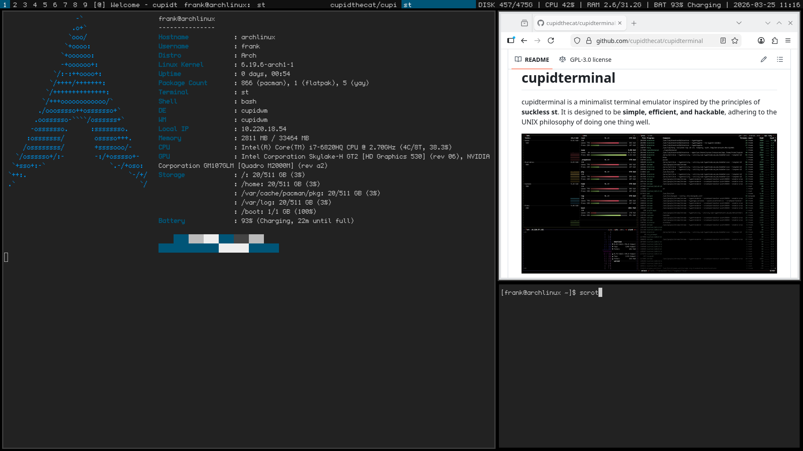

# cupidterminal

cupidterminal is a minimalist X11 terminal emulator derived from suckless
**st**. Upstream st commit
`04ce0d643ed17793803e8516f4c9a5b13b93c400` is the behavioral reference.
Cupid keeps that terminal contract while separating terminal logic from X11
and adding scrollback, combining-mark storage, and font fallback.

The st source is not vendored in this repository. To reproduce the reference
checkout:

```bash
git clone https://git.suckless.org/st st-reference
git -C st-reference checkout 04ce0d643ed17793803e8516f4c9a5b13b93c400
```



## Features

- UTF-8, wide characters, combining marks, and font fallback
- 256-color and truecolor output
- Scrollback, text selection, and primary/clipboard paste
- Mouse reporting, bracketed paste, and application cursor keys
- Non-blocking PTY I/O and live font-size adjustment

See [features](docs/features.md) for supported controls and behavior, and
[source layout](docs/source-layout.md) for the parser/X11 boundary.

## Dependencies

### Arch Linux

```bash
sudo pacman -S base-devel ncurses libx11 libxft fontconfig freetype2 libutf8proc ttf-liberation
```

### Debian / Ubuntu

```bash
sudo apt-get install build-essential ncurses-bin libx11-dev libxft-dev libfontconfig1-dev libfreetype6-dev libutf8proc-dev fonts-liberation
```

## Installation

```bash
git clone https://github.com/cupidthecat/cupidterminal.git
cd cupidterminal
make
sudo make install
```

`make install` installs the binary, manual page, and bundled terminfo entry.
Like upstream st, the child environment defaults to `TERM=st-256color`, so a
local `make && ./cupidterminal` works with the standard st terminfo entry.

```bash
make install-terminfo
```

### TUI apps (btop, etc.)

For btop and similar resource monitors, use a font with Braille (U+2800 to U+28FF), box-drawing (U+2500 to U+257F), and block elements (U+2580 to U+259F). The configured default is `Liberation Mono`; `DejaVu Sans Mono` is another option to try. If graphs look wrong, try `graph_symbol = "block"` in `~/.config/btop/btop.conf` or run `btop -lc` for low-color mode.

## Usage

```bash
./cupidterminal                       # default shell
./cupidterminal -e vim file           # run a command
./cupidterminal -g 100x40             # geometry: cols x rows
./cupidterminal -f "Iosevka:size=12"  # font
./cupidterminal -T "session"          # window title
./cupidterminal -c MyClass            # WM_CLASS for window managers
```

Run `./cupidterminal` with an invalid option for the full flag list, or read
`man cupidterminal` after installation.

## Configuration

Edit `src/config.h` (copied from `src/config.def.h` on first build), then recompile:

```bash
make clean && make
```

Key knobs in `config.h`:

```c
static char *font     = "Liberation Mono:pixelsize=12:antialias=true:autohint=true";
static int   borderpx = 2;
static unsigned int cursorshape = 2;       /* 2=block, 4=underline, 6=bar */
static unsigned int doubleclicktimeout = 300;
static unsigned int blinktimeout       = 800;
static int   bellvolume = 0;               /* -100..100 */
static double minlatency = 2;              /* ms */
static double maxlatency = 33;             /* ms */
```

Color palette (`colorname[]`), kerning (`cwscale` / `chscale`), word delimiters, and the default shell are also in `config.h`. X11-dependent things (keymap tables, modifier macros, the `Shortcut` and `Key` types) live in `src/xconfig.h`.

## Keybindings

Default modifier `TERMMOD = Ctrl+Shift`.

| Keys | Action |
|---|---|
| `Ctrl+Shift+C` | Copy selection to clipboard |
| `Ctrl+Shift+V` | Paste from clipboard |
| `Shift+Insert` | Paste from primary selection |
| `Ctrl+Shift+Y` | Paste primary selection (st alias) |
| `Ctrl+Shift+PgUp` / `Ctrl+Shift+PgDn` | Zoom in / out |
| `Ctrl+Shift+Home` | Reset zoom |
| `Ctrl+Shift+NumLock` | Toggle NumLock |
| `Mouse drag` | Start selection (regular) |
| `Alt+drag` | Rectangular selection |
| `Double-click` | Word snap |
| `Triple-click` | Line snap |
| `Middle-click` | Paste primary selection |

Edit the `shortcuts[]` table in `src/xconfig.h` to rebind.

## Testing

```bash
make test          # unit suites, X11 integration tests, and boundary gate
make test-all      # parser, screen, UTF-8, and PTY suites without X11
make test-parser   # CSI / OSC / control-char / SGR / charset coverage
make test-screen   # cell model, scroll, wrap, selection, combining marks, wide glyphs
make test-utf8     # multi-byte handling
make test-pty      # PTY spawn / reap behavior
make test-x11      # focus, keyboard, TERM, idle redraw, blink, and high-fd tests
```

X11 tests need `Xvfb`, `xdotool`, `xprop`, and `st-256color` terminfo.
On Debian/Ubuntu, install `xvfb xdotool x11-utils ncurses-term`.

Tests use the harness in `test/common/test_common.{c,h}` and link against a `cupid.c` built with `-DCUPID_NO_MAIN`.

## Roadmap

- [ ] **Theming.** Runtime color-scheme switching beyond the OSC 4 / OSC 10/11/12 palette overrides already supported.
- [ ] **Ligature support.** Iosevka or JetBrains style; needs HarfBuzz integration in `xwin.c`.
- [ ] **Sixel / kitty graphics.** Image protocols.
- [ ] **DCS / DECRQM responses.** Fuller VT conformance pass.

## License

cupidterminal and its st-derived portions are released under the
**MIT/X Consortium License**. See `LICENSE`.

## Contributing

PRs welcome. Keep changes minimal and focused, run `make test` before submitting, and follow the cupid.c / xwin.c boundary (no Xlib in `cupid.c`).

## Acknowledgements

Derived from **suckless st** and maintained against the pinned upstream source
as the runtime compatibility reference. See `docs/ST-PARITY.md` for the exact
revision and deliberate Cupid extensions.
